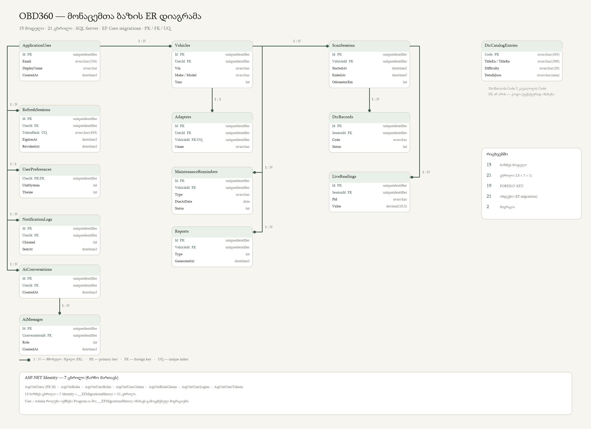

# OBD360 Web — ტექნიკური რეფერენსი (დაცვისთვის)

> სრული, დეტალური მასალა: კრიტერიუმების რუკა, ფაილ/ხაზის მითითებები, Swagger დემო, ტესტები, Docker.
> მოკლე გაცნობისთვის იხილე [`../README.md`](../README.md).

OBD360 Web არის ავტომობილის დიაგნოსტიკის ვებ-პლატფორმა, რომელიც მუშაობს OBD-II Bluetooth ადაპტერთან და აერთიანებს რეალურ დროში მონაცემებს, DTC კოდების ანალიზს, სკანირების ისტორიას, ტექნიკური მომსახურების შეხსენებებსა და AI ასისტენტს.

## ფუნქციონალი

- **რეგისტრაცია / ავტორიზაცია** — JWT access token + rotating refresh cookie.
- **Garage** — მანქანების დამატება, რედაქტირება, წაშლა, ძებნა.
- **Bluetooth** — Web Bluetooth-ით OBD-II ადაპტერთან დაკავშირება.
- **Live Data** — ძრავის ბრუნი, სიჩქარე, ტემპერატურა და სხვა PID-ები.
- **DTC Scanner** — შეცდომების კოდების წაკითხვა და გასუფთავება.
- **DTC Catalog** — 13 629 კოდის ქართული/ინგლისური აღწერა.
- **ECU Modules / Freeze Frame / Graphs** — მოდულები, freeze frame და გრაფიკები.
- **Scan History** — წინა სკანირებების ისტორია.
- **Maintenance Reminders** — შეხსენებები თარიღით; გარბენით — სამომავლო გაუმჯობესება.
- **AI Assistant** — n8n + Google Gemini-ს მეშვეობით ქართულენოვანი დიაგნოსტიკური ახსნები.
- **Critical DTC Alert** — n8n workflow კრიტიკული კოდებისთვის (Telegram).

## არქიტექტურა

| ფენა | ტექნოლოგია |
|---|---|
| Frontend | Angular 22, TypeScript, Signals, Web Bluetooth API |
| Backend | ASP.NET Core Web API (.NET 10), EF Core, SQL Server |
| Auth | ASP.NET Identity, JWT, refresh token cookie |
| Automation | n8n 2.47.4, webhook workflows |
| AI | Google Gemini (`gemini-3.1-flash-lite`) |
| Tests | xUnit + Vitest, 29 backend + 47 frontend |

### C4 მოდელი

| დონე | დიაგრამა | სად |
|---|---|---|
| 1 | System Context — პერსონები და გარე სისტემები | `docs/c4/OBD360 C4.pdf`, გვ. 2 |
| 2 | Container — SPA, API, ბაზა, n8n | გვ. 3 |
| 3 | Component — API-ის შიდა კომპონენტები | გვ. 4 |

ფაილი: [c4/OBD360 C4.pdf](<c4/OBD360 C4.pdf>) (4 გვერდი, PDF-ში ექსპორტირებული).
C4-ის მიხედვით: Person → Software System → Container → Component → Code; აქ პირველი სამი დონეა,
მეოთხე (კოდი) წარმოდგენილია ER დიაგრამითა და თავად კოდით.

## შეფასების კრიტერიუმები — სად რა არის

> სადიპლომო პროექტის აღწერაში მოცემული 5 პროექტი მაგალითია; შეფასების კრიტერიუმები საერთოა
> (Frontend 40 + Backend 40 + დამატებითი 20). ქვემოთ OBD360 ერთი-ერთზეა მიბმული ამ კრიტერიუმებზე.

| # | კრიტერიუმი | ქულა | სად დგას | სტატუსი |
|---|---|---:|---|---|
| 1 | რესპონსიული დიზაინი (HTML/CSS) | 10 | `frontend/src/app/**/*.scss` — 33 `@media`, breakpoints 1100–480 px; მობილური მენიუ `main-layout.ts:42` | ✅ |
| 2 | კომპონენტების სწორი სტრუქტურა (Angular) | 10 | `core/` (services, guards, interceptors, models), `features/` (15 გვერდი), `layout/`; standalone + lazy `loadComponent` | ✅ |
| 3 | მომხმარებლის ინტერფეისის ფუნქციონალობა | 10 | `app.routes.ts`, ფორმები `login/register/garage/reminders/settings`, CRUD + ვალიდაცია + toast | ✅ |
| 4 | State management | 10 | Angular Signals — 92 გამოყენება 23 ფაილში; `computed` + `effect`; იხ. ქვემოთ | ✅ |
| 5 | მონაცემთა ბაზის დიზაინი (SQL) | 10 | `database/schema.sql` (21 ცხრილი, 19 FK, 21 ინდექსი), `seed.sql`, ER დიაგრამა | ✅ |
| 6 | EF Core მოდელები და მიგრაციები | 10 | `Obd360.Core/Entities/`, `Identity/`, `Migrations/`; ავტომატური `MigrateAsync()` | ✅ |
| 7 | REST API endpoints (ASP.NET Core) | 10 | `Obd360.Api/Controllers/` — 8 კონტროლერი, 32 endpoint, JSON | ✅ |
| 8 | ავტორიზაცია / აუტენტიფიკაცია | 10 | Identity + JWT + refresh cookie + როლები + პაროლის აღდგენა | ✅ |
| 9 | კოდის ხარისხი და დოკუმენტაცია | 10 | README, `docs/`, XML კომენტარები, 29 backend + 47 frontend ტესტი | ✅ (⚠️ ტესტების სიღრმე) |
| 10 | პრეზენტაცია | 10 | `docs/პრეზენტაცია/*.pptx`, C4, დემო სცენარი `docs/STUDY.md` | ✅ |

**დამატებითი მოთხოვნები (PDF-იდან):** Git ✅ (21 commit, `github.com/Laziii54/OBD360-Web`), Swagger ✅,
Unit ტესტები ✅ 76, Error handling + logging ✅, README ✅, გაშვების ინსტრუქცია ✅,
ბაზის სკრიპტები ✅ (`schema.sql`, `seed.sql`), პრეზენტაცია ✅.

## REST API vs MVC

ეს პროექტი არის **REST API + Angular SPA**, არა server-side MVC.

| MVC (server-side) | ჩვენი პროექტი |
|---|---|
| Controller აბრუნებს HTML View-ს (`.cshtml`) | Controller აბრუნებს JSON-ს |
| `AddControllersWithViews()` | `AddControllers()` |
| გვერდები სერვერზე გენერირდება | გვერდებს Angular აწყობს |
| `Views/` საქაღალდე | არ არის `Views/` |

როგორ დავამტკიცოთ (დაცვაზე ზედიზედ გახსენი):

1. `Program.cs:19` — `builder.Services.AddControllers();` — **არა** `AddControllersWithViews()`.
2. პროექტში **არ არის** `Views/` საქაღალდე და არც ერთი `.cshtml` ფაილი (`glob **/*.cshtml` → 0).
3. ყველა კონტროლერს აქვს `[ApiController]` + `[Route("api/v1/...")]` და აბრუნებს `ActionResult<T>`/`NoContent()`.
4. მონაცემები გადის DTO-ებში (`Obd360.Api/Dtos/`) და ბრუნდება JSON-ად; HTML გენერაცია არ ხდება.
5. UI ცალკე Angular აპლიკაციაა (`frontend/`), რომელიც `HttpClient`-ით იძახებს `/api/v1/...`-ს.
6. DevTools → Network → `vehicles` request-ის response არის `application/json`, არა `text/html`.

**რა უნდა თქვა:** „MVC აქ მხოლოდ როუტინგისთვის გამოიყენება — Controller/Action. View არ არსებობს:
სერვერი JSON-ს აბრუნებს, გვერდს Angular აწყობს. ამიტომ ეს არის REST API + SPA, არა server-side MVC.“

## მონაცემთა ბაზის დიზაინი

**15 ბიზნეს მოდელი → 21 ფიზიკური ცხრილი** = 13 ბიზნეს ცხრილი + 7 ASP.NET Identity +
`__EFMigrationsHistory` (Identity მხოლოდ მომხმარებლის/როლებისთვისაა, ბიზნეს მონაცემებს არ ეხება).

### მოდელები — სად არის კოდში

| მოდელი | ფაილი |
|---|---|
| ApplicationUser, ApplicationRole | `backend/Obd360.Infrastructure/Identity/ApplicationUser.cs` |
| Vehicle | `backend/Obd360.Core/Entities/Vehicle.cs` |
| Adapter | `backend/Obd360.Core/Entities/Adapter.cs` |
| ScanSession, LiveReading, DtcRecord, DtcCatalogEntry | `backend/Obd360.Core/Entities/ScanSession.cs` |
| MaintenanceReminder | `backend/Obd360.Core/Entities/MaintenanceReminder.cs` |
| AiConversation, AiMessage | `backend/Obd360.Core/Entities/AiConversation.cs` |
| Report, NotificationLog | `backend/Obd360.Core/Entities/Report.cs` |
| UserPreference, RefreshSession | `backend/Obd360.Core/Entities/UserPreference.cs` |

> რამდენიმე კლასი ერთ ფაილშია დაჯგუფებული — `ScanSession.cs` შეიცავს ოთხ კლასს. ამიტომ „15 მოდელი“
> ითვლება კლასებით და არა ფაილებით.

### სქემა, კავშირები და მთლიანობა

| რესურსი | მდებარეობა |
|---|---|
| სრული SQL სქემა — 21 ცხრილი, 19 FK, 21 ინდექსი | `database/schema.sql` |
| საწყისი მონაცემები (როლები + DTC ნიმუშები) | `database/seed.sql` |
| EF Core კონფიგურაცია (FK, index, cascade, decimal) | `backend/Obd360.Infrastructure/Data/ApplicationDbContext.cs` |
| მიგრაციები | `backend/Obd360.Infrastructure/Migrations/` |
| DTC კატალოგის seeder (13 629 კოდი) | `backend/Obd360.Infrastructure/Services/DtcCatalogSeeder.cs` |
| ER დიაგრამა (15 მოდელი, PK/FK) | `docs/report/assets/er-diagram.png` |
| სქემის გენერატორი | `database/generate-schema.ps1` |

დიზაინის გადაწყვეტილებები:

- **1:N** — `ApplicationUser → Vehicles → ScanSessions → {DtcRecords, LiveReadings}`.
- **1:1** — `UserPreferences` (PK = FK `UserId`), `Adapters` (unique `VehicleId`).
- **Unique ინდექსები** — `RefreshSessions.TokenHash` (token-ის ჰეში), `Adapters.VehicleId`,
  `AspNetRoles.NormalizedName`, `AspNetUsers.NormalizedName`.
- **Cascade delete** — მანქანის წაშლისას იშლება სკანირებები, შეხსენებები და რეპორტები;
  `Adapters.UserId` არის `Restrict`, რომ მომხმარებლის წაშლამ ადაპტერი არ „ჩამოკიდოს“.
- **ტიპები** — `uniqueidentifier` PK, `datetime2` დრო, `decimal(10,3)` გაზომვა, `date` ვადა.
- **DTC კატალოგი** — `DtcCatalogEntries`-ის PK არის `Code` (P0300), `DtcRecords.Code` ტექსტური
  მითითებაა (FK არ არის), რომ კატალოგის განახლებამ ისტორია არ დააზიანოს.



### მიგრაციები — როგორ ვაჩვენო

| მიგრაცია | რა აკეთებს |
|---|---|
| `20261028152609_InitialCreate` | 21 ცხრილი, 19 FK, 20 ინდექსი |
| `20261106120000_ExpandDtcCatalog` | `DtcCatalogEntries.Category` ინდექსი + კატალოგის სვეტები |

```powershell
cd backend/Obd360.Api
dotnet ef migrations list                 # რა მიგრაციებია და რომელია გამოყენებული
dotnet ef migrations script -o ..\..\database\migrations.sql   # სუფთა SQL ბაზისთვის
dotnet ef database update                 # ხელით გამოყენება (ჩვეულებრივ არ გჭირდება)
```

API გაშვებისას `Program.cs:145` ავტომატურად ახდენს `db.Database.MigrateAsync()`-ს და შემდეგ
`DtcCatalogSeeder`-ს (Program.cs:148) — ცარიელი ბაზაც თვითონ ივსება.

## გაშვება

### მოთხოვნები

- .NET SDK 10 (ან უფრო ახალი; პროექტი `net10.0`-ზეა)
- Node.js 22+ და npm
- SQL Server (LocalDB ან სრული ინსტანსი)
- n8n 2.47.4 (სურვილისამებრ, AI ფუნქციისთვის)
- `dotnet-ef` tool (მხოლოდ მიგრაციების ხელით სამართავად): `dotnet tool install -g dotnet-ef`

### 1. მონაცემთა ბაზა

`backend/Obd360.Api/appsettings.Development.json`-ში ან user secrets-ში მიუთითე connection string:

```json
"ConnectionStrings": {
  "DefaultConnection": "Server=(localdb)\\MSSQLLocalDB;Database=GeorgianCarScannerWeb;Trusted_Connection=True;MultipleActiveResultSets=true;TrustServerCertificate=True"
}
```

> Development-შიც და Docker-შიც ბაზის სახელია `GeorgianCarScannerWeb`.

API გაშვებისას ავტომატურად უშვებს EF Core მიგრაციებს და DTC კატალოგის seeder-ს.

სუფთა ბაზისთვის შეგიძლია გამოიყენო (ჯერ ბაზა უნდა არსებობდეს):

```powershell
sqlcmd -S "(localdb)\MSSQLLocalDB" -E -Q "CREATE DATABASE Obd360WebDevDb"
sqlcmd -S "(localdb)\MSSQLLocalDB" -E -d GeorgianCarScannerWeb -i database/schema.sql
sqlcmd -S "(localdb)\MSSQLLocalDB" -E -d GeorgianCarScannerWeb -i database/seed.sql
```

> `schema.sql` მიგრაციების იდენტურია (ცხრილები + ინდექსები + FK). თუ მიგრაციები შეიცვალა,
> ხელახლა გენერაცია: `database/generate-schema.ps1` ან `dotnet ef migrations script`.

### 2. Backend

```powershell
sqllocaldb start MSSQLLocalDB
cd backend/Obd360.Api
dotnet run
```

- API: http://localhost:5269
- Swagger: http://localhost:5269/swagger
- Health: http://localhost:5269/health/live

JWT გასაღები user secrets-ში:

```powershell
dotnet user-secrets set "Jwt:SigningKey" "REPLACE_WITH_A_LONG_RANDOM_SECRET"
```

### 3. Frontend

```powershell
cd frontend
npm install
npm start
```

- Frontend: http://localhost:4200
- პირველად გახსენი `Register`, შემდეგ `Login`.

### 4. n8n

```powershell
n8n\start-n8n.cmd
```

n8n: http://localhost:5678

workflow-ების იმპორტი:

```powershell
n8n import:workflow --input="n8n\obd360-scan-report.workflow.json"
n8n import:workflow --input="n8n\obd360-assistant-ask.workflow.json"
n8n import:workflow --input="n8n\obd360-critical-dtc.workflow.json"
```

AI workflow-ები იყენებს n8n-ში შენახულ `googlePalmApi` credential-ს. დეტალები: [n8n/README.md](../n8n/README.md).

#### Telegram alert

`OBD360 Critical DTC Alert` workflow აგზავნის Telegram შეტყობინებას, თუ გაშვებამდე დააყენე:

```powershell
$env:OBD360_TELEGRAM_BOT_TOKEN = "123456:ABC..."
$env:OBD360_TELEGRAM_CHAT_ID = "123456789"
```

Bot token: `@BotFather` → `/newbot`. Chat ID: `@userinfobot` ან `getUpdates`.
თუ env ცვლადები არ არის დაყენებული, workflow იღებს მოთხოვნას, მაგრამ Telegram-ში არ აგზავნის.

## ავტორიზაცია — JWT, refresh token, როლები

| რას აჩვენებ | სად |
|---|---|
| Identity კონფიგურაცია (პაროლის პოლიტიკა, unique email) | `Program.cs:76` |
| JWT ვალიდაცია (issuer, audience, signing key, lifetime) | `Program.cs:88` |
| JWT-ის შექმნა (sub, email, jti, role claims, HS256) | `Infrastructure/Services/TokenService.cs:20` |
| Access token-ის ვადა / refresh-ის ვადა | `appsettings.json` — `Jwt:AccessTokenMinutes` (15), `Jwt:RefreshTokenDays` (30) |
| რეგისტრაცია / login | `AuthController.cs:53`, `:94` |
| Token-ების გაცემა + HttpOnly refresh cookie | `AuthController.cs:283`, cookie `:300` |
| Refresh rotation (ძველი უქმდება) | `AuthController.cs:110`, `:133` |
| Logout | `AuthController.cs:138` |
| როლები: `User` / `Admin` | `Program.cs:155`; `[Authorize(Roles = "Admin")]` `AdminController.cs:13` |
| Frontend: token მეხსიერებაში (sessionStorage) | `core/services/auth.ts:29`, `:116` |
| Frontend: `Authorization: Bearer` header | `core/interceptors/auth-interceptor.ts:8`, `:22` |
| Frontend: 401-ზე ავტომატური refresh | `core/interceptors/auth-interceptor.ts:28` |
| Route guard (ავტორიზაცია / Admin) | `core/guards/auth-guard.ts:6`, `admin-guard.ts:5` |

როგორ ვაჩვენო დაცვაზე: login → DevTools → Application → Cookies → `refreshToken` (HttpOnly, Secure,
SameSite=Strict); Network → request header `Authorization: Bearer eyJ...`; jwt.io-ში token-ის payload
აჩვენებს `sub`, `email`, `role`, `exp`. შემდეგ — 401 სცენარი: token-ის წაშლა → გვერდის განახლება →
interceptor აკეთებს refresh-ს.

## პაროლის აღდგენა

მომხმარებელი ჰკითხულობს ელფოსტას, იღებს **6-ნიშნა კოდს** და აყენებს ახალ პაროლს.

```text
POST /api/v1/auth/forgot-password   { email }
POST /api/v1/auth/reset-password    { email, code, newPassword }
POST /api/v1/auth/change-password   { currentPassword, newPassword }  (ავტორიზებული)
```

უსაფრთხოება:

- კოდი მოქმედებს **10 წუთი**, გამოიყენება **მხოლოდ ერთხელ** და აქვს **5 მცდელობა**.
- არ არსებობს user enumeration — უცნობ ელფოსტაზეც იგივე პასუხი ბრუნდება.
- პაროლის შეცვლის/აღდგენის შემდეგ ყველა refresh session უქმდება.

### SMTP კონფიგურაცია

`appsettings.json`-ში ან environment variables-ით:

```json
"Smtp": {
  "Host": "smtp.gmail.com",
  "Port": 587,
  "UserName": "your@gmail.com",
  "Password": "APP_PASSWORD",
  "FromAddress": "your@gmail.com",
  "FromName": "OBD360",
  "EnableSsl": true
}
```

ან environment variables:

```powershell
$env:Smtp__Host = "smtp.gmail.com"
$env:Smtp__Port = "587"
$env:Smtp__UserName = "your@gmail.com"
$env:Smtp__Password = "APP_PASSWORD"
$env:Smtp__FromAddress = "your@gmail.com"
```

Gmail-ისთვის გამოიყენე **App Password**, არა ჩვეულებრივი პაროლი.
SMTP-ის გარეშე (Development) API კოდს ლოგში წერს და `/auth/forgot-password`-ის პასუხში აბრუნებს
`devCode`-ს, რომ ლოკალურად დემონსტრირება შეიძლებოდეს.

## Reminder email notifications

რემაინდერები ავტომატურად ეგზავნება ელფოსტაზე. ფონური სერვისი:

- მუშაობს API-ის გაშვებისას და შემდეგ ყოველ **6 საათში**.
- ამოწმებს მხოლოდ **თარიღით** ვადაგასულ/დღევანდელ რემაინდერებს (`DueAtDate <= today`).
- ერთ მომხმარებელზე აგზავნის **ერთ digest მეილს** დღეში.
- შედეგი ინახება `NotificationLogs`-ში (`MaintenanceReminder` + `Email`), რომ დუბლიკატი არ გაიგზავნოს.

კონფიგურაცია `appsettings.json`-ში:

```json
"Reminders": {
  "Enabled": true,
  "CheckIntervalMinutes": 360
}
```

> კმ-ით რემაინდერები ჯერ არ იგზავნება, რადგან მანქანის მიმდინარე გარბენი არ ინახება.
> ტესტისთვის შექმენი რემაინდერი დღევანდელი ან გასული თარიღით და გადაუშვი API.

## Admin API

`/api/v1/admin` — მხოლოდ **Admin** როლისთვის. Frontend: `/app/admin`.

- `GET /overview` — users / vehicles / scans / DTC რაოდენობები
- `GET /users?search=` — მომხმარებლები, როლები და აქტივობა
- `DELETE /users/{id}` — მომხმარებლის წაშლა (საკუთარი თავის და ბოლო Admin-ის გარდა)
- `POST /users/{id}/toggle-role` — Admin როლის დამატება/მოხსნა
- `GET /scans?search=` — ყველა მომხმარებლის ბოლო სკანირებები

## Swagger — API დოკუმენტაცია

| რას აჩვენებ | სად |
|---|---|
| Swagger UI (ინტერაქტიული) | `http://localhost:5269/swagger` |
| OpenAPI JSON | `http://localhost:5269/swagger/v1/swagger.json` |
| ალტერნატიული OpenAPI | `http://localhost:5269/openapi/v1.json` |
| სკრინშოტი | `docs/report/assets/swagger.png` |
| კონფიგურაცია | `Program.cs:30` — `AddSwaggerGen`, JWT „Authorize“ ღილაკი `Program.cs:46` |

დემო Swagger-ში (ეს არის „ენდპოინტები მუშაობს“-ის მტკიცებულება):

1. `POST /api/v1/auth/register` → 200 + `accessToken` (ან `login`, თუ უკვე გაქვს).
2. **Authorize** → ჩასვი token **Bearer-ის გარეშე** → Authorize.
3. `GET /api/v1/vehicles` → **200**; token-ის გარეშე → **401**.
4. `POST /api/v1/vehicles` არასწორი VIN-ით → **400** `ValidationProblemDetails`.
5. `GET /api/v1/vehicles/{არარსებული guid}` → **404**.
6. `GET /api/v1/admin/overview` User როლით → **403**, Admin-ით → **200**.

> XML კომენტარები (`/// <summary>`) ამჟამად Auth/Ai/Admin კონტროლერებზეა; დანარჩენებზე endpoint-ები
> მაინც სრულად ჩანს (სქემებითა და ტიპებით), უბრალოდ აღწერის ტექსტის გარეშე.

## Error handling

| სიტუაცია | რა ბრუნდება | სად |
|---|---|---|
| ვალიდაცია | `400` + `ValidationProblemDetails` (ველების შეცდომები) | DTO ატრიბუტები `Obd360.Api/Dtos/*.cs` (26 ატრიბუტი) |
| არაავტორიზებული | `401` | `[Authorize]` ყველა კონტროლერზე, გარდა Auth-ის login/register |
| აკრძალული | `403` | `AdminController.cs:13` — `[Authorize(Roles = "Admin")]` |
| ვერ მოიძებნა | `404` | მაგ. `VehiclesController.cs:58`, `RemindersController.cs:80` |
| კონფლიქტი | `409` | `AuthController.cs:59` (დუბლირებული email), `VehiclesController.cs:72` (VIN) |
| დაუმუშავებელი შეცდომა | `500` + ქართული JSON + ლოგი | `Program.cs:120` — `UseExceptionHandler` |
| Frontend 401 | ავტომატური refresh → თუ ვერა, `/login` | `auth-interceptor.ts:22` |

## Logging

| რა ილოგება | სად |
|---|---|
| HTTP: method, path, status, duration | `Program.cs:21` (`AddHttpLogging`) + `Program.cs:170` (`UseHttpLogging`) |
| რეგისტრაცია / login / წარუმატებელი login | `AuthController.cs:88, 100, 104` |
| პაროლის აღდგენა/შეცვლა | `AuthController.cs:166, 227, 257` |
| რემაინდერის მეილები (წარმატება/შეცდომა) | `ReminderNotificationService.cs` |
| SMTP შეცდომა | `AuthController.cs:191` (`LogError`) |
| დაუმუშავებელი exception | `Program.cs:125` |

ლოგები ჩანს API-ის კონსოლში (Development):

```text
info: Microsoft.AspNetCore.HttpLogging.HttpLoggingMiddleware[1]
      Request: GET /api/v1/vehicles
info: Microsoft.AspNetCore.HttpLogging.HttpLoggingMiddleware[2]
      Response: StatusCode: 200, Duration: 42.7ms
```

## State management — Angular Signals

**რა არის:** state management პასუხობს კითხვას — სად ინახება ეკრანის მონაცემები და როგორ ახლდება
ინტერფეისი მათ ცვლილებაზე. NgRx არ გამოიყენება; გამოყენებულია Angular-ის **Signals** (fine-grained
reactivity): `signal` ინახავს მნიშვნელობას, `computed` ითვლის წარმოებულს, `effect` ასრულებს გვერდით
ეფექტს. ცვლილებისას Angular თავად ახდენს მხოლოდ დამოკიდებული view-ის განახლებას.

| რას მართავს | ფაილი |
|---|---|
| ავტორიზაცია: token + user + `isAuthenticated` | `core/services/auth.ts:29` |
| პარამეტრები: ერთეულები, refresh ინტერვალი (localStorage-ით) | `core/services/user-settings.service.ts:31` + `effect` :36 |
| ადმინი: ტაბები, ძებნა, `filteredUsers`, `filteredScans` | `features/admin/admin.ts:22–58` |
| გვერდითი მენიუ (მობილური) | `layout/main-layout/main-layout.ts:42` + `effect` :45 |
| Garage / Reminders / Scan History / DTC Catalog | შესაბამისი `features/*.ts` |

მაგალითი — `admin.ts`:

```ts
readonly userSearch = signal('');
readonly filteredUsers = computed(() => {
  const term = this.userSearch().trim().toLowerCase();
  return this.users().filter((user) => user.email.toLowerCase().includes(term));
});
```

**რა უნდა თქვა:** „`signal` არის რეაქტიული ცვლადი. `computed` მასზე დამოკიდებული გამოთვლაა —
`userSearch`-ის შეცვლისას სია ავტომატურად გადაითვლება და ეკრანი განახლდება; `effect` ინახავს
პარამეტრს localStorage-ში. ეს არის state management components-ის დონეზე, service-ებით.“

სულ: **92** `signal/computed/effect` გამოყენება **23** ფაილში.

## მომხმარებლის ინტერფეისი და რესპონსიულობა

| გვერდი | URL | ფუნქციონალი |
|---|---|---|
| Login / Register | `/login`, `/register` | ავტორიზაცია, ვალიდაცია, შეცდომები |
| Forgot password | `/forgot-password` | 6-ნიშნა კოდი, ახალი პაროლი |
| Dashboard | `/app/dashboard` | ბარათები, live data, ბოლო სკანირება |
| Garage | `/app/garage` | მანქანების CRUD, VIN ვალიდაცია |
| Reminders | `/app/reminders` | შეხსენებები, ვადაგასული, დასრულება |
| Bluetooth | `/app/bluetooth` | Web Bluetooth, ადაპტერთან დაკავშირება |
| Live Data | `/app/live-data` | PID-ების რეალურ დროში კითხვა |
| DTC Scanner | `/app/dtc-scanner` | 03/07/0A, გასუფთავება |
| ECU Modules / Freeze Frame / Graphs | `/app/ecu-modules`, `/app/freeze-frame`, `/app/graphs` | მოდულები, მონიშვნა, გრაფიკები |
| Scan History | `/app/scan-history` | ისტორია, დეტალები |
| AI Assistant | `/app/ai-assistant` | n8n/Gemini დიაგნოსტიკა |
| Settings | `/app/settings` | ერთეულები, პაროლი, თემა |
| Admin | `/app/admin` | users/roles/scans (მხოლოდ Admin) |

რესპონსიულობა: 33 `@media` წესი (breakpoints 1100/1000/950/900/720/700/650/640/520/480 px +
`prefers-reduced-motion`); 720 px-ზე გვერდითი მენიუ იმალება და იხსნება burger-ით
(`main-layout.ts:42`, `HostListener` :65). ცხრილები მობილურზე ბარათებად იშლება
(`dashboard.scss`, `garage.scss`, `reminders.scss`).

## API

| მეთოდი | მისამართი | აღწერა |
|---|---|---|
| POST | `/api/v1/auth/register` | რეგისტრაცია |
| POST | `/api/v1/auth/login` | ავტორიზაცია |
| POST | `/api/v1/auth/refresh` | token-ის განახლება |
| POST | `/api/v1/auth/logout` | გასვლა |
| POST | `/api/v1/auth/forgot-password` | აღდგენის კოდის გაგზავნა |
| POST | `/api/v1/auth/reset-password` | კოდით ახალი პაროლის დაყენება |
| POST | `/api/v1/auth/change-password` | პაროლის შეცვლა (ავტორიზებული) |
| GET/PUT | `/api/v1/preferences` | პარამეტრები |
| GET/POST | `/api/v1/vehicles` | მანქანების სია / დამატება |
| GET/PUT/DELETE | `/api/v1/vehicles/{id}` | მანქანის ნახვა / რედაქტირება / წაშლა |
| GET/POST | `/api/v1/reminders` | შეხსენებები |
| PUT/DELETE | `/api/v1/reminders/{id}` | შეხსენების რედაქტირება / წაშლა |
| POST | `/api/v1/reminders/{id}/complete` | შეხსენების დასრულება |
| GET/POST | `/api/v1/scans` | სკანირების ისტორია / ახალი სკანირება |
| GET | `/api/v1/dtc-catalog?search=&page=&pageSize=` | DTC კატალოგი |
| GET | `/api/v1/dtc-catalog/{code}` | კოდის დეტალები |
| GET | `/api/v1/ai/status` | AI ინტეგრაციის სტატუსი |
| POST | `/api/v1/ai/latest-scan-report` | ბოლო სკანირების AI რეპორტი |
| POST | `/api/v1/ai/ask` | AI ასისტენტის კითხვა |
| GET | `/api/v1/ai/conversation` | საუბრის ისტორია |
| GET | `/api/v1/admin/overview` | ადმინის სტატისტიკა |
| GET | `/api/v1/admin/users?search=` | მომხმარებლების სია |
| DELETE | `/api/v1/admin/users/{id}` | მომხმარებლის წაშლა |
| POST | `/api/v1/admin/users/{id}/toggle-role` | Admin როლის გადართვა |
| GET | `/api/v1/admin/scans?search=` | ყველა სკანირება |

## პრეზენტაცია

- `docs/პრეზენტაცია/პრეზენტაცია.pptx` — **16 სლაიდი** (მიმდინარე ვერსია)
- სლაიდებში: OBD-II/ECU დიაგრამა, **რეალური ადაპტერისა და მანქანის 16-pin პორტის ფოტოები** (სლაიდი 4), DTC კატალოგი (13,629), არქიტექტურა, უსაფრთხოება, AI, დემო და ტესტები.

## დოკუმენტაცია

| დოკუმენტი | რა არის |
|---|---|
| `README.md` (ეს ფაილი) | სრული ტექნიკური დოკუმენტაცია + გაშვება + კრიტერიუმები |
| `docs/report/OBD360-Web-Documentation.docx/.pdf` | 36-გვერდიანი აკადემიური დოკუმენტაცია |
| `docs/STUDY.md` | სწავლის ფურცელი: კოდის რუკა, დემო, 10 კითხვა-პასუხი |
| `docs/c4/OBD360 C4.pdf` | C4: Context, Container, Component |
| `docs/report/assets/er-diagram.png` | ER დიაგრამა (15 მოდელი, PK/FK) |

აკადემიური დოკუმენტაცია მოიცავს: OBD-II თეორია, არქიტექტურა, მონაცემთა მოდელი, API, OBD-II კოდი,
უსაფრთხოება, ტესტირება, გაშვება და მომხმარებლის გზამკვლევი.

## სწავლის ფურცელი

`docs/STUDY.md` — ერთი გვერდი: სად არის რა, დემო 6 ნაბიჯად, 10 კითხვა-პასუხი და რიცხვები, რომლებიც უნდა ახსოვდეს.

## ტესტები

### Backend — xUnit (29 ტესტი)

```powershell
cd backend
dotnet test                                   # ყველა
dotnet test --filter "FullyQualifiedName~VehiclesAndReminders"
dotnet test --collect:"XPlat Code Coverage"   # coverage (coverlet)
```

| ფაილი | რას ამოწმებს |
|---|---|
| `Obd360.Tests/Controllers/VehiclesAndRemindersTests.cs` | მანქანის CRUD, მომხმარებლის იზოლაცია, VIN დუბლიკატი, შეხსენების სრული ციკლი, სხვისი მანქანის აკრძალვა |
| `Obd360.Tests/N8n/N8nClientTests.cs` | webhook-ის გამოძახება, retry 5xx-ზე, client error-ზე retry-ის არარსებობა, timeout, health probe |
| `Obd360.Tests/N8n/N8nResponseParserTests.cs` | OpenAI/Anthropic/ტექსტური პასუხის პარსინგი, ცარიელი პასუხი |
| `Obd360.Tests/N8n/ScanPromptBuilderTests.cs` | ქართული prompt-ის აწყობა, კოდების/მიზეზების ჩასმა, ისტორია |

### Frontend — Vitest (47 ტესტი)

```powershell
cd frontend
npm test -- --watch=false
```

| ფაილი | რას ამოწმებს |
|---|---|
| `src/app/core/services/obd-decoder.spec.ts` | **28 ტესტი** — PID-ის ბაიტების პარსინგი, RPM/სიჩქარე/ტემპერატურა/ძაბვა, DTC-ის დეკოდირება (P/C/B/U), CAN და non-CAN პასუხები, multi-frame, VIN, ECU მისამართები, freeze frame, მზადყოფნის მონიტორები, ერთეულების კონვერტაცია |
| 18 `*.spec.ts` (კომპონენტები, `auth`, guards, interceptor) | **19 smoke ტესტი** — კომპონენტის/სერვისის შექმნა |

### შედეგი

```text
Passed! - Failed: 0, Passed: 29, Skipped: 0, Total: 29      (2026-11-21)
Test Files 18 passed (18) / Tests 19 passed (19)            (2026-11-21)
```

> `obd-decoder.spec.ts` დაემატა 2026-11-24-ს; მისი 28 ტესტი უნდა გაეშვას `npm test`-ით.
> ლოგიკა დამოწმებულია Node-ზე იმავე ფუნქციების გაშვებით (28/28 ემთხვევა), თუმცა Vitest-ის
> გაშვება ამ გარემოში ვერ მოხერხდა (sandbox ბლოკავს პროცესის spawn-ს).

დეტალები: `README.md` → ეს სექცია.

## პროექტის სტრუქტურა

```
backend/
  Obd360.Api/            Web API, controllers, DTOs, n8n integration
  Obd360.Core/           entities, enums
  Obd360.Infrastructure/ EF Core DbContext, migrations, seeding, Identity
  Obd360.Tests/          xUnit tests
frontend/
  src/app/core/          services, guards, interceptors, models
  src/app/features/      15 feature pages (dashboard, garage, ...)
  src/app/layout/        sidebar, topbar
database/                schema.sql, seed.sql, generate-schema.ps1, DtcCatalog
n8n/                     n8n workflows and start/stop scripts
docs/c4/                 C4 diagrams (PDF)
docs/report/             full documentation, ERD, assets (docx/pdf)
docs/პრეზენტაცია/        presentation (pptx)
```

## Docker

```powershell
docker compose up --build
```

სერვისები:

- Frontend: http://localhost:4200
- API: http://localhost:5269
- Swagger: http://localhost:5269/swagger
- n8n: http://localhost:5678
- SQL Server: localhost:1433

Docker გარემოში connection string, JWT, CORS და Telegram ცვლადები გადაეცემა `docker-compose.yml`-იდან. საჭიროების შემთხვევაში შეცვალე `SQL_PASSWORD`, `JWT_SIGNING_KEY` და `PUBLIC_ORIGIN`.

### DigitalOcean (production)

Production კონფიგურაცია მზადაა, მაგრამ Droplet-ზე ჯერ არ გაშვებულა.

```bash
docker compose -f docker-compose.yml -f docker-compose.prod.yml up -d --build
```

Production override მალავს SQL Server/API/n8n პორტებს და web-ს აკავშირებს მხოლოდ `127.0.0.1:4200`-ზე; TLS-ს ამთავრებს host Nginx.

## შეზღუდვები / Future work

- ყოველკვირეული PDF რეპორტები (Reports) — მოდელი არსებობს, UI/API ჯერ არა.
- Email confirmation — ჯერ არ არის.
- GitHub Actions CI/CD — ჯერ არ არის.
- სრული ინტეგრაციული ტესტები რეალურ SQL Server-ზე.
- DigitalOcean-ის რეალური deployment ჯერ არ გაშვებულა; საჭიროა Droplet/დომენი.
- Frontend ტესტები: 19 smoke + 28 `obd-decoder` ტესტი; დარჩენილია ინტერცეპტორისა და guard-ების
  ქცევითი ტესტები.
- Login-ზე არ არის lockout/rate limiting (Identity-ის `Lockout` არ არის ჩართული).
- Swagger ჩართულია ყველა გარემოში (`Program.cs:164`); Production-ში ღირს დაფარვა ან ავტორიზაცია.

## დემო სცენარი (20 წუთი)

| # | რას აჩვენებ | სად |
|---|---|---|
| 1 | README + გაშვების ინსტრუქცია | `README.md` |
| 2 | Swagger + JWT Authorize | `http://localhost:5269/swagger` |
| 3 | ბაზა: 21 ცხრილი, FK, ინდექსები, ERD | `database/schema.sql`, `docs/report/assets/er-diagram.png` |
| 4 | მიგრაციები + ავტომატური გაშვება | `Migrations/`, `Program.cs:145` |
| 5 | Login/JWT/refresh/პაროლის აღდგენა | `AuthController.cs`, `TokenService.cs` |
| 6 | UI: dashboard, garage, reminders, admin, მობილური მენიუ | `http://localhost:4200` |
| 7 | Signals (state) | `admin.ts:32`, `user-settings.service.ts:36` |
| 8 | ტესტები | `dotnet test`, `npm test` |
| 9 | error handling + logging | `Program.cs:120`, API კონსოლი |
| 10 | C4 + პრეზენტაცია | `docs/c4/`, `docs/პრეზენტაცია/` |

დეტალები: [`STUDY.md`](STUDY.md).

## ავტორი

ზურაბ ლაზაშვილი — OBD360 Web, 2026.

